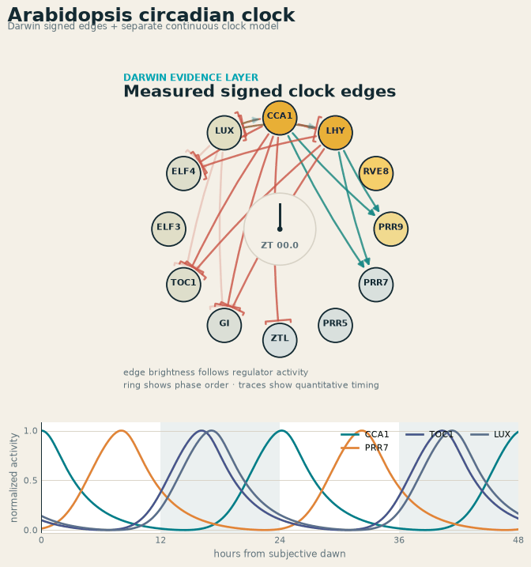
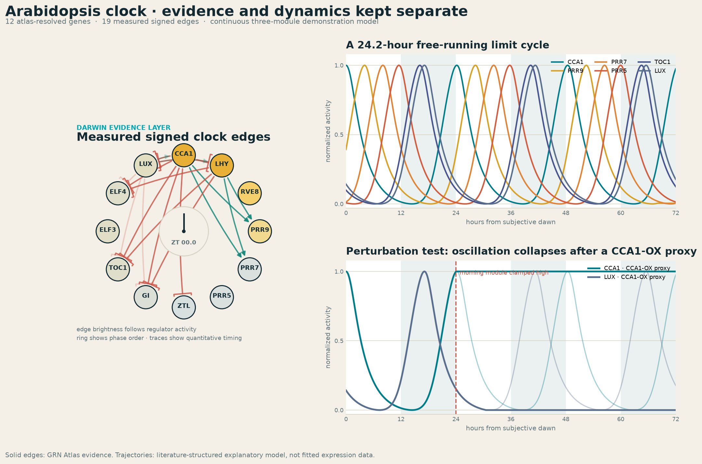

# A Clock Needs Time: An Arabidopsis Circadian Demonstration in Darwin

Author: CAIRN Institute

Published: October 12, 2026

Read time: 7–9 minutes

#GeneRegulation #CircadianBiology #Arabidopsis #SystemsBiology #PlantScience #AIforScience

## Quick Summary

Darwin can now analyze the qualitative dynamics of a signed gene-regulatory module. Given a set
of genes, it retrieves supported activation and repression edges, reports how much of the module
has signed evidence, and tests whether a Boolean abstraction reaches a fixed point or a cycle.

The Arabidopsis circadian clock is a useful demonstration—and an important boundary test. A
signed wiring diagram is not enough to reproduce a biological clock. Oscillation also requires
time: delayed feedback, accumulation, turnover and phase relationships.

We therefore built this demonstration in two explicitly separate layers:

- Darwin resolves 12 Arabidopsis clock genes and retrieves 19 measured signed regulatory edges,
  including confidence and provenance.
- A compact continuous model adds the temporal assumptions needed to produce a repeating
  morning-to-evening cycle.

The result is a 24.2-hour illustrative limit cycle and a qualitative CCA1-overexpression test in
which rhythmicity collapses. The period and amplitudes are model outputs, not expression
measurements or parameters inferred by GRN Atlas.

## The Goal

Our broader goal is to move from a regulatory network that can be inspected to one that can be
used to formulate testable dynamic hypotheses.

A static network can answer questions such as:

- Which transcription factors regulate a gene?
- Is an interaction activating or repressive?
- What experimental sources support that sign?
- Which genes may respond downstream of a perturbation?

A clock asks harder questions:

- In what order do regulators become active?
- How long does a regulator remain effective after its transcript changes?
- Does feedback settle into a stable state or sustain an oscillation?
- Does a perturbation change phase, period, amplitude or rhythmicity?

Those questions cannot be answered from connectivity alone.

## Why the First Simulation Was Not a Clock

Darwin's general `grn-dynamics` operation uses synchronous Boolean threshold updates. An active
activator contributes a positive input, an active repressor contributes a negative input, and all
genes update together. This is useful for qualitative attractor and perturbation analysis.

For the clock genes, however, an all-ON starting state reaches a fixed point after three update
steps. It does not oscillate. That result is not a failed biological clock; it is the correct answer
to a different question: what attractor does this particular Boolean abstraction reach?

Presenting that fixed point as circadian behavior would conflate regulatory signs with kinetic
dynamics. The new demonstration preserves the Boolean result as a comparison and introduces a
separate time-aware model for the clock.

## What Darwin Contributes

The demonstration begins with stable Arabidopsis locus identifiers for CCA1, LHY, RVE8, PRR9,
PRR7, PRR5, ZTL, GI, TOC1, ELF3, ELF4 and LUX/PCL1.

Darwin then retrieves the signed subnetwork among those genes from the rebuilt GRN Atlas:

| Evidence result | Current demonstration |
| --- | ---: |
| Atlas-resolved clock genes | 12 |
| Non-self measured signed edges | 19 |
| Edges represented in ATRM and PlantRegMap | 19 |
| Edges with additional DAP-seq support | 4 |
| Signed coverage of the induced atlas subnetwork | 70.4% |

The solid arrows in the animation are those atlas edges. Green denotes activation, red denotes
repression, and edge brightness follows the modeled activity of the source regulator. Confidence,
source databases, identifiers and available publication links remain attached to the evidence
record rather than being collapsed into the animation.

## Adding the Time Dimension

The continuous layer is a compact three-module repressilator based on established Arabidopsis
clock architecture:

1. A morning module represents CCA1/LHY-associated activity.
2. A daytime module represents the sequential PRR program.
3. An evening module represents TOC1/GI and evening-complex activity.

The modules form a delayed sequence of repression: morning represses evening, evening represses
the daytime PRR program, and the PRR program represses morning activity. Each module follows a
continuous Hill-repression equation. In simplified form:

`d(morning)/dt = basal + alpha / (1 + day^hill) - decay × morning`

The same form is rotated through the three modules. Gene-level phase offsets spread the module
signals into the expected progression from dawn-associated CCA1/LHY through PRR9, PRR7, PRR5,
TOC1 and the evening complex.

The parameters were selected to create a stable free-running demonstration with a 24.2-hour
period. They were not fitted to an Arabidopsis time course. The trajectories should therefore be
read as a mechanistic illustration of delayed feedback, not as predicted transcript abundance.

## A Perturbation With a Known Direction

Constitutive CCA1 expression is a useful qualitative check because CCA1-overexpressing
Arabidopsis plants are known to lose normal circadian rhythmicity.

At hour 24, the demonstration clamps the combined morning module high. Evening activity falls,
the PRR-associated state becomes fixed and the repeating cycle collapses. The direction of the
result is consistent with the known phenotype.

This is still a proxy. The compact model groups CCA1 and LHY and does not reproduce a specific
transgenic line, tissue, light regime or expression magnitude. Its defensible claim is narrower:
a known clock-disrupting intervention also disrupts the modeled feedback cycle.

## What Is New in Darwin

This work adds a clearer route from atlas evidence to dynamic hypothesis generation:

- species-aware resolution of regulatory modules;
- retrieval of activation and repression signs with provenance;
- qualitative Boolean attractor analysis for general signed subnetworks;
- explicit separation between atlas evidence and external kinetic assumptions;
- reproducible dynamic demonstrations with evidence manifests and perturbation comparisons.

The separation is the important design choice. Darwin can supply a defensible regulatory graph,
but a dynamic model must state where its delays, rates, initial conditions and perturbation rules
come from.

## What This Demonstration Does—and Does Not—Show

It shows that Darwin can assemble and audit the evidence layer for a biologically recognizable
regulatory system, pass that layer into a separate dynamic model, and preserve the distinction
between observed edges and modeled behavior.

It does not show that 19 signed edges are sufficient to infer a circadian clock, that the plotted
curves are measured expression, or that a 24.2-hour period was learned from sequence. A predictive
clock model would require time-series expression, protein abundance and turnover, light and
temperature inputs, tissue context, fitted kinetic parameters, and validation against independent
perturbations.

That boundary is not a limitation to hide. It is the line between a plausible animation and a
testable systems-biology model.

## Next Steps

The next scientific step is calibration rather than additional visual complexity. We plan to:

- fit phase and amplitude against public Arabidopsis time courses;
- separate mRNA and protein states;
- represent evening-complex assembly and ZTL-mediated protein turnover;
- model light/dark entrainment and free-running conditions separately;
- test multiple perturbations, including CCA1/LHY, PRR and evening-complex mutants;
- score predictions against held-out temporal and perturbation measurements.

The current demonstration establishes the architecture for that work: Darwin supplies the
traceable regulatory evidence, while the dynamic layer remains explicit, replaceable and
independently testable.

## References

- Pokhilko et al. (2012), “The clock gene circuit in Arabidopsis includes a repressilator with
  additional feedback loops.” Molecular Systems Biology. https://doi.org/10.1038/msb.2012.6
- Fogelmark and Troein (2014), “Rethinking Transcriptional Activation in the Arabidopsis
  Circadian Clock.” PLOS Computational Biology. https://doi.org/10.1371/journal.pcbi.1003705
- Wang and Tobin (1998), “Constitutive expression of the CIRCADIAN CLOCK ASSOCIATED 1 gene
  disrupts circadian rhythms and suppresses its own expression.” Cell. PMID: 9657153.
