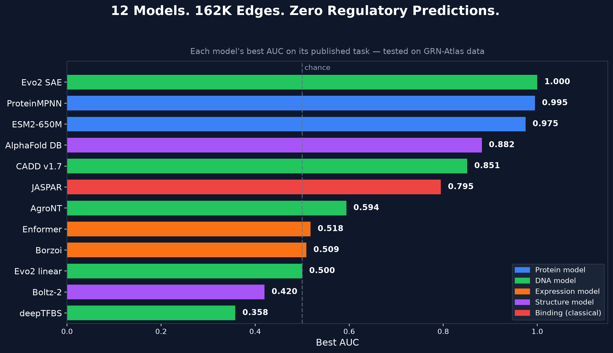
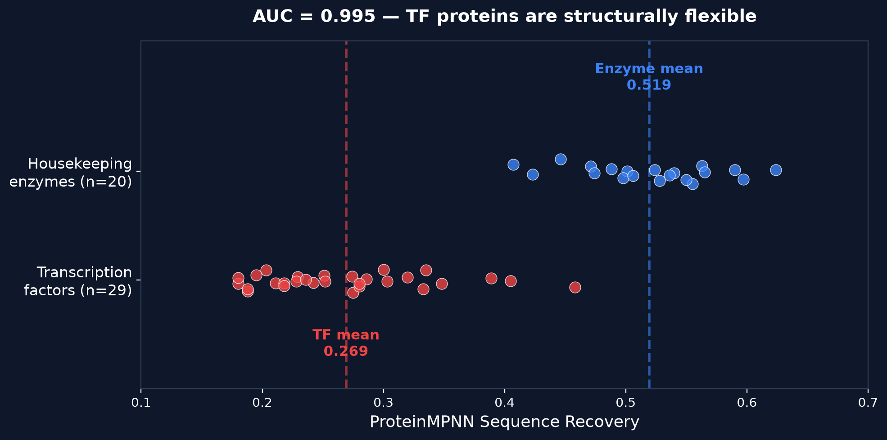
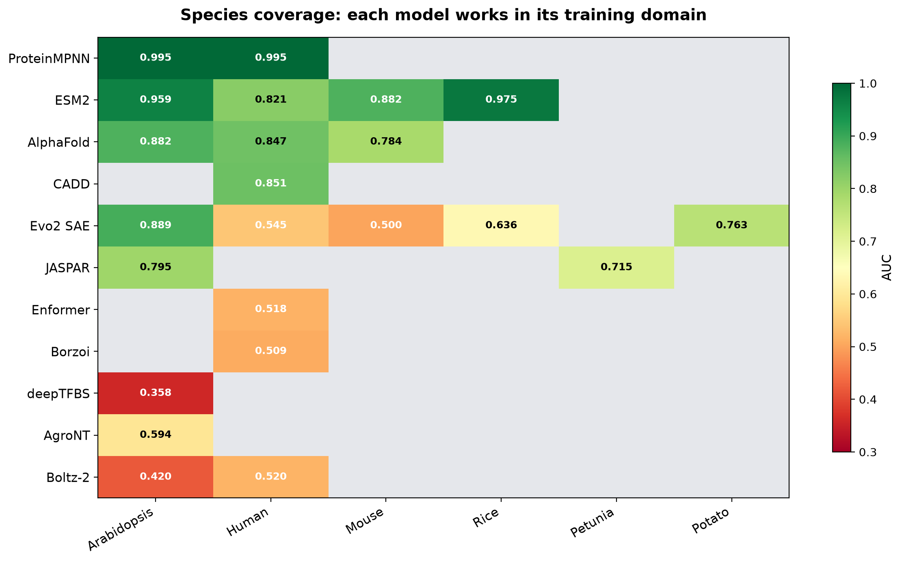

# We Tested 12 Deep Learning Models on Real Regulatory Data. Here's What They Actually Do.

Author: CAIRN Institute

Published: November 2, 2026

Read time: 10-12 minutes

#Genomics #DeepLearning #GeneRegulation #Bioinformatics #SystemsBiology #PlantScience

## Quick Summary

Every few months a new deep learning model promises to decode gene regulation. We took 12 of them — from protein language models to DNA foundation models to structure predictors — and tested each one against our GRN-Atlas dataset: 162,000 candidate regulatory edges across 8 species, from Arabidopsis to human.

The finding is clear and consistent: **every model excels at its published task, but none of them predict which genes a transcription factor actually regulates.**

This isn't a failure of the models. It's a map of what "gene regulation" actually requires — and where the field's tools stop short.

*All 12 tested models ranked by their best AUC on their published task, tested against GRN-Atlas data. Color indicates model type: blue = protein, green = DNA, orange = expression, purple = structure, red = binding (classical). The dashed line marks chance performance (0.5).*

## The Gap Between Binding and Regulation

We started where most people start: can deep learning models predict whether a transcription factor binds a target gene's promoter?

We tested 15 binding prediction approaches, from classical motif scanning (JASPAR, HOMER) to neural networks trained on ChIP-seq data (deepTFBS, Enformer, Borzoi) to structure prediction (Boltz-2). The best performer was JASPAR motif scanning at AUC 0.795 in Arabidopsis — a decades-old method beating every neural alternative we tried.

| Approach | Species | AUC | Verdict |
| --- | --- | ---: | --- |
| JASPAR motif scanning | Arabidopsis | 0.795 | Best binding discriminator |
| JASPAR motif scanning | Petunia | 0.715 | Cross-species transfer works |
| AgroNT-1B | Arabidopsis | 0.594 | Weak signal, massive overfit |
| Boltz-2 (large-scale) | Human | 0.520 | No signal |
| Enformer | Human | 0.518 | Chance level at scale |
| Borzoi | Human | 0.509 | Chance level |
| Evo2 linear probe | Arabidopsis | 0.500 | No signal |
| Boltz-2 (large-scale) | Arabidopsis | 0.420 | Below chance |
| deepTFBS | Arabidopsis | 0.358 | Anti-discriminates |

But here's the deeper problem. Even perfect binding prediction wouldn't solve regulatory network inference. A transcription factor can bind thousands of promoters. Only a fraction of those binding events actually change gene expression. The gap between "binds DNA here" and "regulates this gene" is enormous, and no current model bridges it.

## What Each Model Is Actually Good At

Rather than force models into a task they weren't built for, we tested each one on what it claims to do — using our data as the benchmark.

### ESM2-650M: the TF classifier

Meta's protein language model turned out to be remarkably useful. Its 1,280-dimensional embeddings classify transcription factors from non-TFs at AUC 0.975 in rice and 0.959 in Arabidopsis. It discriminates TF families almost perfectly: 12 of 15 pairwise comparisons hit AUC 1.0 in Arabidopsis. And it captures cross-species conservation — MYB embeddings from Arabidopsis and human have cosine similarity 0.991.

ESM2 doesn't tell you what a TF regulates, but it tells you exactly what kind of TF it is.

| Species | n (TF + nonTF) | CV-AUC | Task |
| --- | --- | ---: | --- |
| Rice | 50 + 50 | 0.975 | TF vs non-TF classification |
| Arabidopsis | 50 + 50 | 0.959 | TF vs non-TF classification |
| Mouse | 50 + 50 | 0.882 | TF vs non-TF classification |
| Human | 50 + 50 | 0.821 | TF vs non-TF classification |

### ProteinMPNN: the designability discriminator

The Baker lab's sequence design model produced the strongest single discrimination we measured: AUC 0.995 separating TFs from housekeeping enzymes by structural designability. TFs average 27% sequence recovery versus 52% for enzymes like GAPDH and enolase. Their DNA-binding domains and disordered activation regions create backbone geometries that don't constrain sequence choice.

But all TF families look equally "flexible" to ProteinMPNN — it can't distinguish a WRKY from a MYB the way ESM2 can.

*ProteinMPNN sequence recovery: transcription factors (red, n=29) versus housekeeping enzymes (blue, n=20). The near-perfect separation (AUC 0.995) reflects a fundamental structural difference — TF proteins are inherently flexible.*

### AlphaFold DB: the disorder detector

AlphaFold tells a complementary story through predicted structural confidence. TFs consistently score lower pLDDT (~63 vs ~76 for non-TFs), reflecting their intrinsically disordered regions. This signal holds across Arabidopsis (AUC 0.882), human (0.847), and mouse (0.784).

AlphaFold can also partially discriminate TF families by their structural profiles (median pairwise AUC 0.894), catching differences like the zinc-finger fold of WRKY proteins versus the helix-turn-helix of MYBs.

### CADD v1.7: the conservation scorer

CADD reliably identifies functionally important genomic regions in human (AUC 0.851 for TSS-proximal vs intergenic), but can't distinguish a highly connected regulatory hub from a low-connectivity one (AUC 0.523). It measures evolutionary conservation, not regulatory wiring.

### Evo2: the phylogenomic encoder

Evo2's Goodfire SAE features perfectly classify species (AUC 1.0) and coding versus non-coding sequence (AUC 1.0), and discriminate Arabidopsis promoters at AUC 0.889. It's a powerful phylogenomic encoder — but a phylogenomic encoder is not a regulatory predictor.

The SAE learned a clear gradient: dicot signal is strongest (Arabidopsis 0.889, potato 0.763), monocot is weaker (rice 0.636), and mammal signal is absent (human 0.545, mouse 0.500). The SAE was trained preferentially on plant genomic data, and its features reflect that bias.

## The Pattern

Across all 12 models, the same pattern repeats:

- **Protein models** (ESM2, ProteinMPNN, AlphaFold) — excellent at characterizing TF proteins, blind to regulatory targets
- **DNA models** (Evo2, CADD, JASPAR) — good at classifying genomic sequences, can't predict regulatory connectivity
- **Expression models** (Enformer, Borzoi) — trained on expression from sequence, not on which TF drives which gene

No model bridges protein identity to regulatory function. That bridge requires integrating binding evidence, perturbation data, expression patterns, evolutionary conservation, and chromatin state — exactly the kind of multi-evidence synthesis that GRN-Atlas is built to do.

## Species Coverage

Not every model works in every species. The heatmap below shows which model-species combinations we tested and how they performed.

*Species coverage matrix: green cells indicate strong performance, red cells indicate poor performance, gray cells indicate the model was not tested for that species. The diagonal pattern is clear — each model performs best on species close to its training data.*

ESM2 is the broadest: strong across Arabidopsis, human, mouse, and rice. JASPAR transfers well across plant species (Arabidopsis and petunia). Most neural models are locked to human or Arabidopsis.

For non-model plant species, the toolkit is thin. UniProt and Ensembl coverage drops sharply outside the major model organisms, limiting protein-based and variant-based approaches.

## Model Capability Summary

| Model | Best task | Best AUC | Predicts regulatory edges? |
| --- | --- | ---: | --- |
| ProteinMPNN | TF vs enzyme designability | 0.995 | No |
| ESM2-650M | TF classification (rice) | 0.975 | No |
| Evo2 SAE | Species classification | 1.000 | No |
| AlphaFold DB | TF structural confidence | 0.882 | No |
| CADD v1.7 | TSS vs intergenic (human) | 0.851 | No |
| JASPAR | Binding prediction (Arabidopsis) | 0.795 | Partial (binding only) |
| AgroNT-1B | Binding (Arabidopsis) | 0.594 | No (overfits) |
| Enformer | Binding (human) | 0.518 | No |
| Borzoi | Binding (human) | 0.509 | No |
| Evo2 linear probe | Binding | 0.500 | No |
| Boltz-2 | Binding | 0.420 | No |
| deepTFBS | Binding (Arabidopsis) | 0.358 | No (anti-discriminates) |

## What This Means

Deep learning hasn't solved gene regulation. But it has produced genuinely useful tools for pieces of the puzzle:

- **ESM2 embeddings** can validate and classify TF annotations across species
- **ProteinMPNN and AlphaFold** can flag structurally atypical proteins and confirm TF characteristics
- **Evo2 features** can classify sequences and detect phylogenomic signatures
- **JASPAR motif scanning** remains the most practical binding discriminator for plant species

The regulatory edge — *this TF controls that gene* — still requires experimental evidence: perturbation experiments, chromatin accessibility, and expression time series. Models can annotate, classify, and validate. They can't yet replace the biology.

## Methods

All calibrations used our GRN-Atlas dataset: 162,000 candidate regulatory edges across 8 species (human, mouse, Arabidopsis, tomato, petunia, pepper, potato, rice).

**Protein characterization tasks** (ESM2, AlphaFold): 5-fold stratified cross-validation with L1 logistic probes, C-sweep [0.01, 0.1, 1.0, 10.0], n=50+50 per species. Features: ESM2 1,280-dim embeddings; AlphaFold 9 pLDDT-derived features.

**ProteinMPNN**: Sequence recovery and perplexity scored on AlphaFold-predicted structures. v_48_020 checkpoint, GPU (RTX 5070 Ti). n=29 TFs (Arabidopsis + human) vs n=20 housekeeping enzymes (human). AUC computed on recovery scores directly.

**Binding prediction tasks**: n=50+50 (large-scale) or n=20+20 (pilot), positive controls from measured interactions (ConnecTF, AGRIS AtRegNet, ChIP-seq), negative controls from random TF-gene pairs excluding known edges.

**CADD**: PHRED scores from CADD v1.7 REST API. TSS-proximal (1kb window) vs intergenic regions.

**Evo2**: 40B parameter model, Goodfire SAE (32K features), layer-26 hidden states (8,192-dim), 200bp DNA windows.

All calibration data, scripts, and results are available in the [GRN-Atlas repository](https://github.com/CAIRN-Institute/grn-atlas).

## Further Reading

- [Darwin repository (GRN Atlas)](https://github.com/cairninstitute/grn-atlas)
- [CAIRN Institute](https://www.cairninstitute.com/)

Questions or feedback? Contact us at info@cairninstitute.com.

© 2026 CAIRN Institute | Advancing AI for the Public Good
